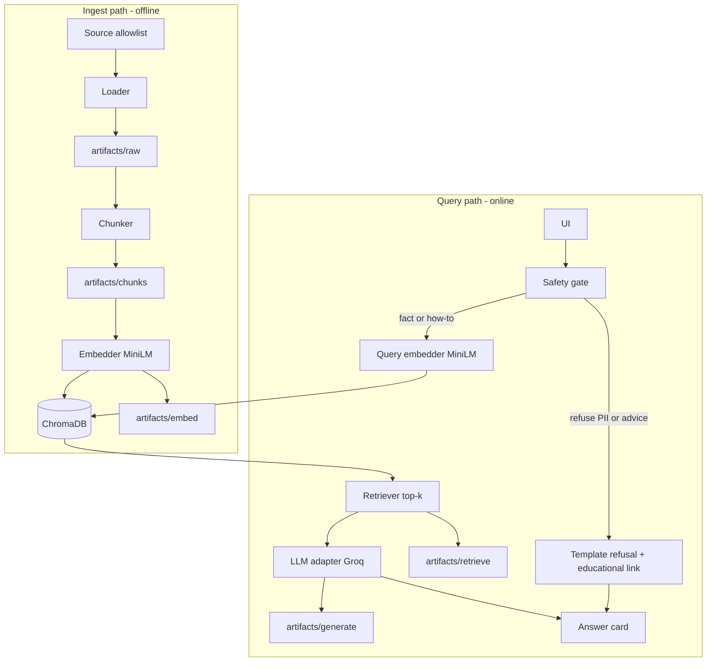
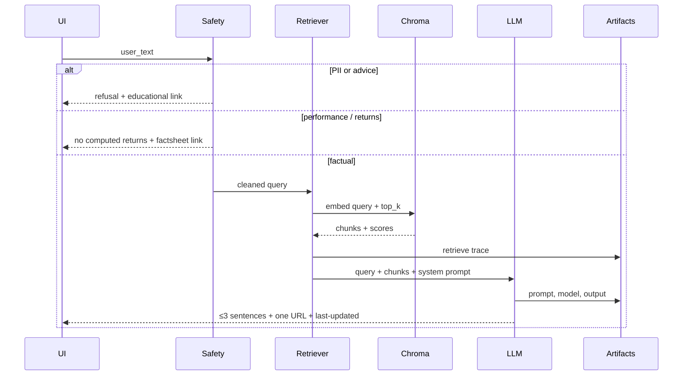

# Architecture: Groww Mutual Fund FAQ Assistant

| Field | Value |
| --- | --- |
| Product | Groww Mutual Fund FAQ Assistant (facts-only RAG prototype) |
| Status | Draft |
| Source | `DOC/PRD.md` |
| Last updated | 2026-11-01 |

This document describes **how** the PRD is built: two pipelines (ingest and query), inspectable artifacts at every RAG stage, and a tiny UI. It is a demo architecture, not a production crawler or advice engine.

---

## 1. Design goals

1. **RAG only** — answers come from retrieved public-page chunks, not model memory.
2. **Inspectable by stage** — load, chunk, embed, retrieve, and generate each persist files that can be shown in a demo.
3. **Config-driven** — embedding model, Chroma, chunking, top-k, allowlist, and LLM provider/model change without editing application logic.
4. **Safe by default** — PII and advice are refused **before** retrieval/logging; performance questions never compute returns.
5. **One citation** — the generator may see top-k chunks but the user-facing answer carries exactly one source URL.

---

## 2. System context

```text
                    allowlisted public pages
                    (Groww / AMC / AMFI / SEBI)
                              |
                              v
                     +----------------+
                     | Ingest pipeline| ----> artifacts/ + Chroma persist
                     +----------------+
                              |
                              v
User  -->  Tiny UI  -->  Query pipeline  -->  Groq LLM (model from .env)
                |              |
                |              +--> retrieval + generate traces
                v
         Answer card
         (≤3 sentences, 1 link, last-updated)
```

**Actors**

| Actor | Interaction |
| --- | --- |
| Retail / support user | Types a question in the UI; never logs in |
| Operator (demo) | Runs ingest; opens stage artifacts or the UI demo panel |
| External LLM | Groq in v1; other providers are adapters behind the same interface |

**Trust boundary:** user text is untrusted. Only URLs on the config allowlist may be fetched. Secrets stay in `.env`. User PII is not written to disk.

---

## 3. High-level architecture

Two decoupled paths share config, the embedding model, and the same Chroma collection.



Ingest is batch and repeatable. Query is request-scoped. If ingest has not been run, the UI should fail closed with a setup message, not invent facts.

---

## 4. Repository layout

Proposed layout so each PRD phase maps to a folder and an artifact directory.

```text
groww-chatbot/
  DOC/
    Problemstatement.txt
    PRD.md
    architecture.md
  config/
    config.yaml              # models, chroma, chunking, top_k, allowlist, UI copy
  .env.example
  src/
    config_loader.py
    ingest/
      load.py
      chunk.py
      embed.py
      index.py
    query/
      safety.py
      retrieve.py
      generate.py
      pipeline.py
    llm/
      base.py
      groq_client.py         # v1
      openai_client.py       # stub / later
      gemini_client.py
      anthropic_client.py
      mistral_client.py
    ui/
      app.py                 # Streamlit (tiny UI + demo panel)
  artifacts/
    raw/
    chunks/
    embed/
    retrieve/
    generate/
  data/
    chroma/                  # Chroma persist dir (gitignored)
  sources/
    sources.csv              # 15–25 URLs used
  samples/
    qa.md
  README.md
```

**UI choice:** Streamlit for v1 — small surface, easy local run, and a sidebar for RAG traces. A notebook is an acceptable fallback if hosting is not required.

---

## 5. Configuration and secrets

Split **behavior** (`config.yaml`) from **secrets / model ids** (`.env`) as required by the PRD.

### 5.1 `config.yaml`

| Key | Purpose |
| --- | --- |
| `embedding.model` | `sentence-transformers/all-MiniLM-L6-v2` |
| `chunk.strategy` | `section_aware` (default) or `recursive` |
| `chunk.size` / `chunk.overlap` | Fallback splitter params |
| `chroma.persist_dir` | Local persist path |
| `chroma.collection` | Collection name |
| `chroma.distance` | Distance metric |
| `retrieval.top_k` | Chunks passed to the LLM |
| `sources.allowlist` | Official URLs only |
| `llm.provider` | `groq` default |
| `ui.welcome` / `ui.examples` / `ui.disclaimer` | Tiny UI copy |
| `safety.educational_link` | AMFI/SEBI/Groww explainer used on refusals |
| `safety.factsheet_fallback_url` | Official factsheet when returns are asked |

### 5.2 `.env`

```text
GROQ_API_KEY=
LLM_MODEL=                    # Groq slug; not hardcoded
# Optional later
OPENAI_API_KEY=
GEMINI_API_KEY=
ANTHROPIC_API_KEY=
MISTRAL_API_KEY=
```

`LLM_MODEL` is read at runtime so the problem-statement slug can be replaced with a live Groq id without a code change.

---

## 6. Ingest pipeline (Phases 1–4)

Run as a CLI (e.g. `python -m src.ingest`). Each step writes artifacts even if a later step fails.

### 6.1 Load

- Read allowlisted URLs from config (seed 5, grow to 15–25).
- HTTP GET with a conservative user-agent, timeout, and no login.
- Extract visible text (prefer static HTML). If the page is JS-heavy, store raw HTML and document the fallback in README.
- **Do not** use screenshots of the Groww app backend or third-party blogs.

**Artifact `artifacts/raw/<page_id>.json`**

```json
{
  "page_id": "hdfc-large-cap-direct-growth",
  "url": "https://groww.in/mutual-funds/hdfc-large-cap-fund-direct-growth",
  "fetched_at": "2026-11-01T06:00:00Z",
  "http_status": 200,
  "scheme_or_amc": "HDFC Large Cap Fund Direct Growth",
  "text_path": "artifacts/raw/hdfc-large-cap-direct-growth.txt"
}
```

### 6.2 Chunk

Corpus is semi-structured (labels, values, short FAQ copy). Default strategy:

1. Split on headings / fact rows / FAQ blocks (`section_aware`).
2. Keep a fact and its label in the same chunk (expense ratio with its value).
3. If a block exceeds `chunk.size`, recursive character split with overlap.

**Artifact `artifacts/chunks/chunks.jsonl`** — one object per chunk:

| Field | Notes |
| --- | --- |
| `chunk_id` | Stable id, e.g. `{page_id}::{section}::{n}` |
| `source_url` | Citation candidate |
| `scheme_or_amc` | Filter / display |
| `section` | e.g. `expense_ratio`, `exit_load`, `overview` |
| `text` | Chunk body |
| `fetched_at` | Inherited from load; drives “Last updated from sources” |

### 6.3 Embed

- Model: `sentence-transformers/all-MiniLM-L6-v2` from config.
- Encode chunk text only; metadata stays unembedded.
- Dimension is whatever the model returns (384 for MiniLM); record it in the job log.

**Artifact `artifacts/embed/job.json`**

```json
{
  "model": "sentence-transformers/all-MiniLM-L6-v2",
  "dim": 384,
  "chunk_count": 0,
  "embedded_at": "2026-11-01T06:05:00Z"
}
```

Optional: `artifacts/embed/vectors.npy` plus `ids.json` for an offline demo without opening Chroma.

### 6.4 Index (ChromaDB)

- Same persist dir and collection as query time.
- Store `chunk_id` as the Chroma id.
- Metadata: `source_url`, `scheme_or_amc`, `section`, `fetched_at`.
- Document field: chunk `text`.

Re-ingest is **replace collection** (small corpus), not incremental upsert, so demos stay reproducible.

---

## 7. Query pipeline (Phases 5–7)

Entry point: `src.query.pipeline.run(user_text) -> Answer`.



### 7.1 Safety gate (before retrieve and before logging)

Order of checks:

1. **PII** — PAN, Aadhaar, account numbers, OTP-like tokens, emails, phones. Drop the payload; do not write `artifacts/retrieve` or chat logs with the raw text. Return the PII refusal template.
2. **Advice** — buy/sell/switch/best/should I. Return polite refusal + `safety.educational_link`. Skip retrieval (no need to ground an opinion).
3. **Performance** — returns, CAGR, beat the benchmark. Do not compute or compare. Return a short message + official factsheet link.
4. **Fact / how-to** — continue to retrieval.

Implementation: regex / keyword rules for v1 (sufficient for the sample eval set). An LLM classifier is optional later and must not store PII if used.

### 7.2 Retrieve

- Embed the query with the **same** MiniLM model as ingest.
- Query the **same** Chroma collection.
- Return `top_k` documents with distances/scores and metadata.

**Artifact `artifacts/retrieve/<request_id>.json`**

```json
{
  "request_id": "…",
  "query": "Expense ratio of HDFC Large Cap Fund Direct Growth?",
  "model": "sentence-transformers/all-MiniLM-L6-v2",
  "top_k": 4,
  "hits": [
    {
      "chunk_id": "…",
      "score": 0.0,
      "source_url": "https://groww.in/…",
      "section": "expense_ratio",
      "text": "…"
    }
  ]
}
```

If max score is below a config threshold, treat as **unknown**: do not call the LLM to invent a number; return “not in loaded sources” plus the closest official URL if any hit exists.

### 7.3 Generate

- Provider from `config.llm.provider` (Groq v1).
- Model id from `LLM_MODEL` in `.env`.
- Adapter interface: `complete(system, user) -> str` so Gemini / OpenAI / Anthropic / Mistral can be dropped in later.

**System prompt rules (W1/W2)**

- Answer only the asked fact.
- Use retrieved chunks; never invent expense ratio, SIP, lock-in, exit load, riskometer, or benchmark.
- ≤ 3 sentences.
- Include exactly one source URL (the best-matching chunk’s `source_url`).
- Append `Last updated from sources: YYYY-MM-DD` from that chunk’s `fetched_at`.
- If chunks conflict or lack the fact, say so and still cite one official page.

**Artifact `artifacts/generate/<request_id>.json`** — system prompt, user prompt, provider, model, raw completion, parsed citation, final display text.

Query-stage artifacts for **allowed** fact questions may store the query. They must not store PII. Advice/performance refusals can store a redacted intent label instead of the full message if needed for the demo.

---

## 8. LLM adapter

```text
LLMClient.complete(system: str, user: str) -> str
```

| Provider | v1 |
| --- | --- |
| Groq | Implemented |
| Gemini, OpenAI, Anthropic, Mistral | Same interface; unimplemented clients raise a clear “not configured” error |

Selection:

```text
provider = config.llm.provider
model    = env.LLM_MODEL
```

No provider SDK calls from the UI layer — only through `src.llm`.

---

## 9. Application / UI

Streamlit (or equivalent) with two regions:

| Region | Content |
| --- | --- |
| Main | Welcome line, 3 example question buttons, disclaimer “Facts-only. No investment advice.”, input, answer card |
| Demo panel | Last request’s retrieve hits (chunk, score, URL) and generate metadata (model, citation) |

Answer card fields:

- `text` (≤ 3 sentences)
- `source_url` (one)
- `last_updated` (`Last updated from sources: YYYY-MM-DD`)
- `mode`: `fact` | `refuse_advice` | `refuse_pii` | `refuse_performance` | `unknown`

No account, no session store beyond in-memory chat for the demo. Example questions are read from config.

---

## 10. Data contracts

### 10.1 `Answer`

```text
text: str
source_url: str | None
last_updated: str | None
mode: Literal[fact, refuse_advice, refuse_pii, refuse_performance, unknown]
request_id: str
trace_paths: { retrieve?: path, generate?: path }
```

### 10.2 Identity of a fact

Retrieval should prefer chunks whose `section` matches the asked attribute (`expense_ratio`, `exit_load`, `min_sip`, `lock_in`, `riskometer`, `benchmark`, `statements`). Section tags are assigned at chunk time from headings/labels, not by the LLM.

---

## 11. Safety and compliance (architecture view)

| Control | Where it lives |
| --- | --- |
| Public sources only | HTTP loader uses allowlist; citation URLs must be in that list |
| No PII persist | Safety gate before artifact writers and Chroma (Chroma never stores queries that failed PII) |
| No advice | Gate + prompt; advice path skips retrieve |
| No performance claims | Gate returns factsheet link; prompt also forbids computing returns |
| Citation integrity | Generator is instructed to copy `source_url` from a retrieved chunk, not invent a URL |
| Secrets | `.env` gitignored; never sent to Chroma |

Educational and factsheet links used in refusals are still allowlisted official pages.

---

## 12. Runtime and dependencies (v1)

| Concern | Choice |
| --- | --- |
| Language | Python 3.11+ |
| Embeddings | `sentence-transformers` |
| Vector DB | ChromaDB (persistent local) |
| LLM | Groq API |
| UI | Streamlit |
| HTTP | `httpx` or `requests` + HTML text extract (`trafilatura` or BeautifulSoup) |

No GPU required. MiniLM runs on CPU. Groq is the only networked inference call on the query path (plus first-time model download for MiniLM).

---

## 13. Mapping to PRD phases

| Phase | Architecture component | Checkpoint |
| --- | --- | --- |
| 0 | `config.yaml`, `.env.example`, package skeleton | App boots with missing index message |
| 1 | `ingest/load.py` | `artifacts/raw` for 5 seed URLs |
| 2 | `ingest/chunk.py` | `chunks.jsonl` + strategy note in README |
| 3 | `ingest/embed.py` | `artifacts/embed/job.json` |
| 4 | `ingest/index.py` | Queryable Chroma collection |
| 5 | `query/retrieve.py` | Retrieve traces for sample questions |
| 6 | `query/safety.py` + `query/generate.py` + Groq adapter | Fact answers and refusals |
| 7 | `ui/app.py` | Tiny UI + demo panel |
| 8 | `sources/`, `samples/qa.md`, README | Deliverables pack |

---

## 14. Failure modes

| Failure | Behavior |
| --- | --- |
| Empty / missing Chroma | UI tells operator to run ingest |
| Fetch 4xx/5xx | Record status in raw metadata; skip page; do not crash the batch |
| Layout change | Raw snapshot still on disk; chunker may yield weaker sections — README known limit |
| Retrieval miss | `unknown` mode; no invented numbers |
| Groq down / bad model slug | Surface config error; do not fall back to ungrounded local generation |
| PII in input | Refuse; no artifact for raw user text |

---

## 15. Out of scope for this architecture

- Auth, KYC, holdings, or Groww private APIs
- Multi-AMC production crawl
- Fine-tuning
- Computing or ranking returns
- Writing user chat history to a server

---

## 16. Open implementation notes

These close PRD open decisions for v1 unless product overrides them:

1. **UI:** Streamlit app with in-product demo panel **and** files under `artifacts/`.
2. **Model slug:** from `.env`; document the working Groq id in README after a live check.
3. **Corpus growth:** add official factsheets / AMFI / SEBI URLs in `config.yaml` until 15–25 sources; keep the five HDFC seed pages mandatory.
4. **Chunking:** `section_aware` default, recursive fallback, both config-selectable.
